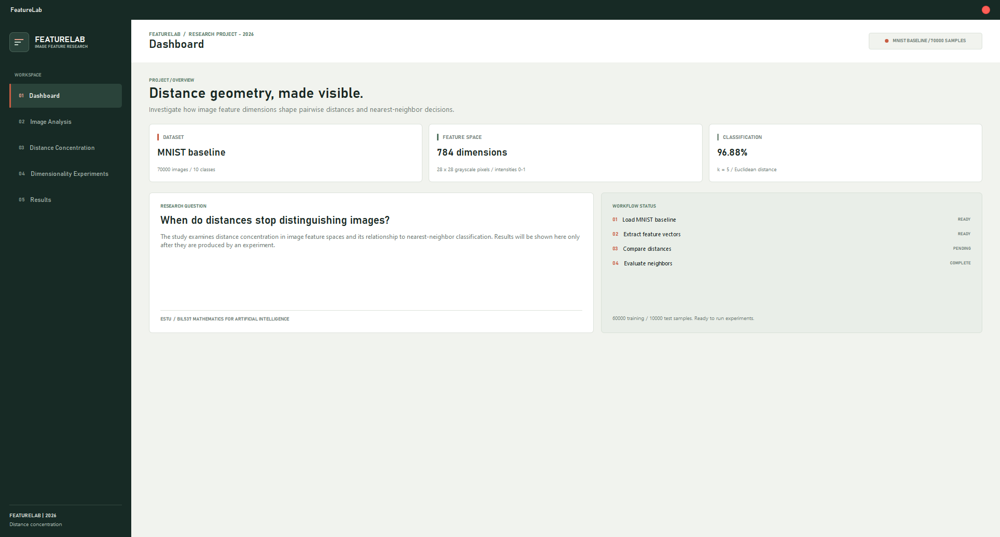
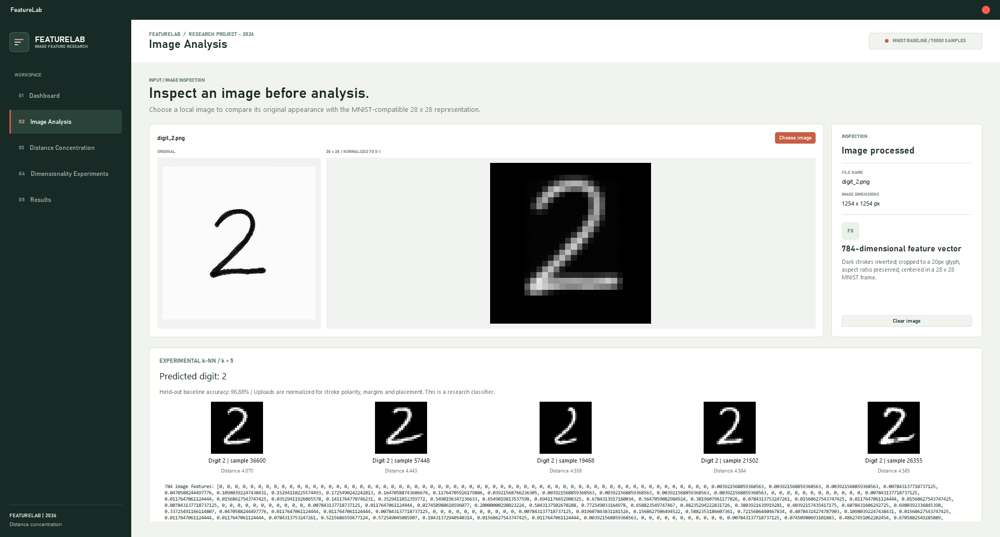

# FeatureLab — MNIST

FeatureLab is a PyQt6 and Qt Quick/QML desktop research application for **Investigating Distance Concentration in Image Feature Spaces and Its Effect on Nearest-Neighbor Classification**. **TensorFlow/Keras MNIST is the established dataset** for digit predictions, distance analysis and future development.

## Application screenshots

Captured from the running Windows application using the complete MNIST dataset.

### Dashboard

The dashboard shows 70,000 MNIST images, 784 features per image, and the measured **96.88%** full-test baseline accuracy.



### Image Analysis: digit 2

Testing `test_digits/digit_2.png` produces **Predicted digit: 2**. The page shows the original image, its normalized 28 x 28 representation, and five nearest training images, all labeled **2**.



## Install and launch

Validated with Python 3.13.12 on Windows. Activate the existing environment or create a new one, then install the dependencies:

```powershell
.\imagefeatureenv\Scripts\Activate.ps1
# Alternatively:
py -3.13 -m venv .venv
.\.venv\Scripts\Activate.ps1
python -m pip install -r requirements.txt
python .\main.py
```

To use the project interpreter directly:

```powershell
.\imagefeatureenv\Scripts\python.exe .\main.py
```

`requirements.txt` pins direct dependencies, including TensorFlow 2.21.0. `requirements-lock.txt` records the complete validated environment. The first launch needs internet access to let Keras download MNIST (approximately 11.5 MB); later launches reuse its verified cache under `data/keras/datasets/mnist.npz` (or an explicitly configured `KERAS_HOME`). No manual dataset folder or image download is needed.

The dataset is initialized on the main thread before constructing QML, so the window opens with its data ready. Importing TensorFlow and reading the archive can take several seconds. Baseline evaluation and experiments run in background tasks. You can make predictions and navigate while accuracy is being evaluated. Closing the app interrupts long evaluations/experiments between batches and waits for workers to stop safely.

The borderless window fills the available desktop work area while leaving the taskbar visible. Its custom title bar has a red circular close button at the top right and no minimize/maximize controls. Local system fonts are registered if Qt cannot discover them.

## Dataset and prediction

The loader calls [`tf.keras.datasets.mnist.load_data()`](https://www.tensorflow.org/api_docs/python/tf/keras/datasets/mnist/load_data):

- **60,000 training images and 10,000 test images**, using MNIST's official split without mixing or re-splitting them.
- **28 x 28 grayscale images**, **784 pixel features**, ten classes (0–9).
- Original images remain read-only `uint8` values in [0,255]. Feature vectors are read-only `float32` values normalized to [0,1].
- Copies and matrix blocks are bounded to keep the larger dataset usable on a desktop.

Prediction uses **Euclidean k-NN with k=5 and uniform voting**, against all **60,000 official training images**. TensorFlow supplies the dataset; this version does not train a neural network. Equal-distance neighbors use training order, and tied label votes choose the smallest label. Repeated predictions reuse the training references. Neighbor records identify both the training position and the original MNIST dataset index.

The baseline evaluation displayed by the application compares the original **10,000 official test images** against all 60,000 training images. The measured full-test accuracy is **96.88% (9,688 correct predictions out of 10,000)**. This full evaluation is cached using a fingerprint of the feature values, labels and partitions, together with k and the algorithm version. Later launches reuse that verified measurement; changes invalidate it and trigger recalculation. A fresh full evaluation takes longer than a single prediction and is independent of dataset availability. Its measured result is recorded in [results/mnist/baseline.json](results/mnist/baseline.json). This accuracy describes MNIST test images, not arbitrary external handwriting.

## Uploaded-image preprocessing

PNG, JPG and JPEG images are decoded from byte buffers, supporting Unicode paths on Windows. Transparent images are composited over white and 16-bit PNG values are converted to 8-bit.

For uploaded digit classification:

1. Convert to grayscale and infer background polarity from border pixels.
2. Convert dark-on-light strokes to MNIST's light-on-dark representation.
3. Find the foreground and discard tiny isolated specks while retaining separate substantial strokes.
4. Crop excess margins and resize the glyph to fit within 20 x 20 pixels, preserving aspect ratio.
5. Place it in a 28 x 28 black frame and align its center of mass with the image center.
6. Normalize the 784 feature values to [0,1].

Native 28 x 28 inputs retain their geometry and original intensities, with polarity correction when needed. Blank uploads report an error. The lower-level `preprocess_image` function also supports basic grayscale extraction with `normalize_digit=False`; the app and `predict_image_with_knn` enable normalization explicitly.

The Image Analysis page shows original/processed images, normalization details, the predicted digit, five nearest training images, their labels/distances and the feature vector. The supplied stylized `digit_2.png` predicts **2**, with all five nearest full-training references labeled **2** in the prediction regression check. That image is a regression fixture only and is never added to training.

## Research experiments

Predictions and the application's baseline use the complete official training/test sets. **Research experiments use a reproducible stratified subset of 5,000 training and 1,000 test images** to make repeated distance calculations practical. Each subset is selected independently inside its official partition using seed 42; no test image becomes a training reference. The same subset is reused across every condition in a run.

The Results page's original-feature accuracy is therefore a **subset experiment result**, which can differ from the full-data baseline on the Dashboard. Exported metadata records the sample counts and both local and original MNIST indices.

| Experiment | Conditions | Randomness |
| --- | --- | --- |
| Synthetic validation | Uniform[0,1] vector pairs in dimensions 2, 4, 8, 16, 32, 64, 128, 256; 2,000 pairs per dimension | Generator seed 42 |
| Irrelevant features | 784 original features, then 1024, 1568 and 2352 total features | Independent Uniform[0,1] appended coordinates; seeds 0, 1 and 2 |
| Preprocessing comparison | Original 784 features; standardized 784; PCA with 16 and 32 components | Training-only fitting; randomized PCA solver, seed 42 |

The original 784 pixels are preserved during augmentation. Standardization and PCA are separate conditions; PCA operates on the original features rather than standardized features. Each transformer is fitted exactly once on training samples and reused for test samples. The unchanged 784-feature baseline is repeated across noise seeds as a consistency check.

The UI uses these fixed conditions. The CLI can change the research subset sizes while retaining the official partition boundaries:

```powershell
python .\run_experiments.py --output results/mnist
# Smaller reproducible smoke run:
python .\run_experiments.py --output results/smoke --train-samples 600 --test-samples 100
```

Exports contain full measured JSON records, a comparison CSV and six PNG charts. NumPy arrays, source indices, per-query extrema/contrasts, predictions and per-seed metrics are retained. JSON represents non-finite contrast as the string `"Infinity"` instead of invalid JSON numbers.

The recorded 5,000/1,000 MNIST experiment produced:

| Condition | Distance CV | k-NN test accuracy |
| --- | ---: | ---: |
| Original 784 | 0.14191 | 94.30% |
| Irrelevant 1024 | 0.10082 | 93.53% |
| Irrelevant 1568 | 0.06199 | 92.10% |
| Irrelevant 2352 | 0.04044 | 90.47% |
| Standardized | 0.44540 | 90.50% |
| PCA 16 | 0.21153 | 94.00% |
| PCA 32 | 0.17719 | 95.20% |

See [comparison.csv](results/mnist/comparison.csv) and [results.json](results/mnist/results.json). These results concern a fixed MNIST subset and protocol. Adding irrelevant features reduced distance variability and accuracy in this run; PCA 32 improved subset accuracy. The measurements do not establish that accuracy must decrease whenever dimension increases.

## Metrics and charts

Euclidean distance is `D(x,y)=sqrt(sum_j (x_j-y_j)^2)`; squared distance is the sum without the square root. Variance and standard deviation use population definitions (`ddof=0`). Ordinary-distance CV is `std(D)/mean(D)`; squared-distance CV is `std(D^2)/mean(D^2)`.

For each image condition, mean/std/CV cover **all test-to-training distances** within the research subset, not only five neighbors. Relative contrast is computed for each query as `(farthest-nearest)/nearest`, then averaged. An exact zero minimum with a positive maximum gives infinity; all-zero distances give contrast/CV zero by convention. Small positive distances are preserved. Near-identical matrix-distance pairs are recomputed directly to avoid cancellation errors.

The six Results charts show:

1. **Dimensionality comparison:** mean distance and accuracy as irrelevant dimensions are added.
2. **Distance concentration:** all-distance CV against feature count; lower CV indicates less relative distance variability.
3. **Relative distance contrast:** mean per-query nearest/farthest contrast.
4. **Classification performance:** held-out accuracy across representations. Error bars show population standard deviation across noise seeds, not confidence intervals.
5. **Nearest-distance distributions:** one nearest training-reference distance per test query (pooled across noise seeds where applicable).
6. **Synthetic theoretical validation:** empirical versus theoretical squared-distance CV.

For independent Uniform[0,1] coordinates, synthetic predictions are `E[D^2]=d/6`, `Var(D^2)=7d/180`, and `CV(D^2)=sqrt(7/(5d))`. Ordinary-distance CV is stored separately. Absolute distances from standardized and raw features have different scales and should not be interpreted as directly interchangeable.

The separate Distance Concentration page compares one selected official test image against all 60,000 training images and shows its measured histogram, mean, variance, CV, contrast, nearest and farthest references.

## Architecture and validation

```text
main.py                         Qt application and dataset initialization
run_experiments.py              Reproducible research suite and export
app/backend/datasets/           TensorFlow MNIST loader and official-split subsets
app/backend/image_processing/   MNIST-compatible upload normalization
app/backend/calculations/       Mathematical metrics and bounded distance blocks
app/backend/machine_learning/   Euclidean k-NN and cached training references
app/backend/experiments/        Shared experiment evaluation and real charts
app/services/                   Background tasks, previews, fonts and exports
app/viewmodels/                 Qt properties, commands and worker result handling
ui/                             Custom window bar, shared components, five pages
tests/                          Numerical, data, preprocessing, ML, export and GUI tests
data/keras/                     Ignored TensorFlow/Keras download cache
results/mnist/                  Actual MNIST records and figures
```

Scikit-learn remains a dependency for `StandardScaler`, PCA and stratified subset selection; **its Digits dataset is not used anywhere in the active application or tests**. Local project prompts in `.prompts/` and `.prompt` (if present) are excluded from Git. The downloaded MNIST cache and local backup archives are also ignored; source code, tests, documentation and measured MNIST results can be committed normally.

```powershell
python -m pytest tests -q
python -m pip check
```

Tests cover numerical formulas and edge cases; bounded float32-reference/float64-distance calculations; cutoff ties and cancellation; MNIST dimensions, normalization, immutability and official split boundaries; reproducible subsets; training-only transformations; upload polarity/padding/transparency/blank states; the supplied 2; actual entry-point readiness; QML navigation; taskbar-preserving custom controls; chart rendering; export and recovery. Most regression tests use a small, explicitly selected real MNIST subset for speed. Full-source shape and real-process startup tests verify the production dataset; full baseline measurements are recorded separately.

Recorded MNIST validation: **106 tests passed, 0 failed**. Dependency checks, Python compilation and whitespace checks passed.

Qt GUI checks use offscreen software rendering. Native file dialogs, GPU/driver behavior and other operating systems still require manual testing. Dependency versions are recorded, but a fresh installation on other hardware has not been independently reproduced.

## Limitations

MNIST contains handwriting rather than every possible font or symbol. Unusual decorations, rotations, multiple characters and complex backgrounds can still be misclassified. Automatic deskewing and multi-digit segmentation are not implemented. The reported baseline is a benchmark on official MNIST test images, not an external-upload accuracy guarantee. Research subset results and three noise seeds do not quantify uncertainty across alternative dataset partitions. TensorFlow's first import and an uncached full baseline evaluation can take time; data readiness and uploaded-image predictions do not wait for the baseline result.
